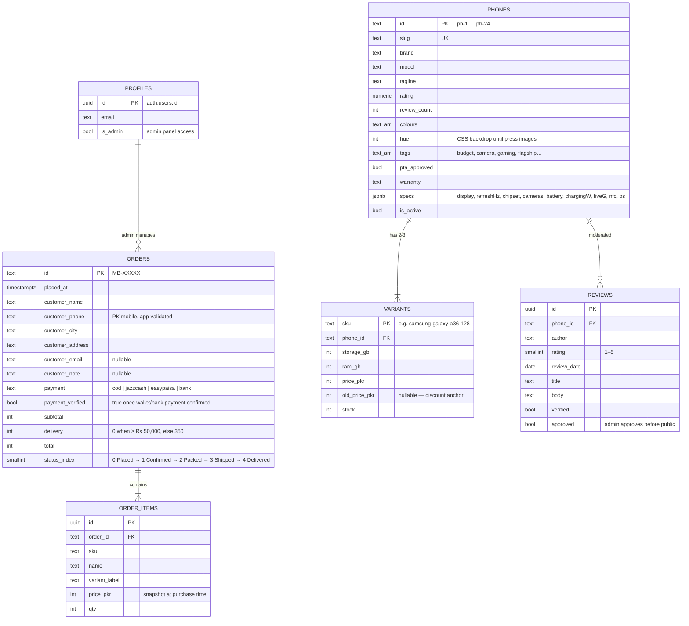

# MobileBazaar — Entity-Relationship Diagram (FYP documentation)

Paste the Mermaid block below into the SRS / design chapter. It matches
`supabase/migrations/001_initial_schema.sql` and `lib/types.ts` exactly.

## Relationship notes (for the viva)

- **phones → variants** is 1:N with cascade delete; every variant carries its own
  PKR price and stock — this is the core of the Product → Variants model and the
  reason discounts and EMI are computed per variant, not per phone.
- **orders → order_items** is 1:N with cascade delete; `price_pkr` on the item is
  a snapshot so a later price change never rewrites history — an examiner will
  ask about this.
- **Guest checkout**: orders are inserted with the anon key (no login). RLS
  allows `INSERT` for everyone but `SELECT` only for admins; the Track Order page
  reads through a server-side route with the service-role key, never the anon key.
- **reviews** are write-by-authenticated, read-when-approved — the moderation
  queue is the admin panel's third screen after catalogue and orders.
